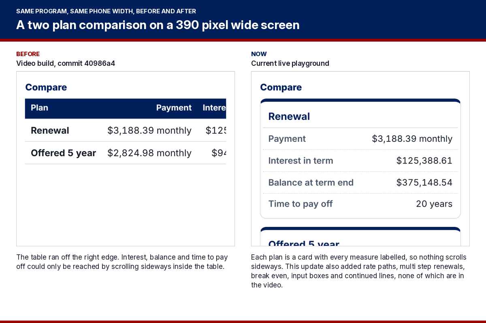

# Renew

[](https://github.com/ALENZACODES/renew-lang/actions/workflows/pages.yml)

**A small language for Canadian mortgage renewal decisions.**

## Start here

Open the [playground](https://alenzacodes.github.io/renew-lang/playground/). Read the 2026 renewal example below, or paste it in. Change the discount in the box above the editor; the program text stays the same. Or run it with no install: `node bin/renew.js run examples/01-renewal-2026.renew`. The language reference is [docs/LANGUAGE.md](docs/LANGUAGE.md).

**Playground:** https://alenzacodes.github.io/renew-lang/playground/

**Embed example:** https://alenzacodes.github.io/renew-lang/examples/embed.html





When a mortgage term ends, the borrower has a few weeks to compare a handful of choices: renew for five years, take a shorter term, change the amortization to keep the payment, pay extra. Each choice is a small calculation, usually done in a spreadsheet or an online calculator that answers one case at a time. Renew turns the decision into a short program you can read, run, share and rerun when rates move.

## Who it is for

Renew is for a borrower coming up to renewal who is comfortable editing a short text file, and for developers who want renewal maths they can read, test and compile into their own page. It is not meant to replace a conversation with a lender. It is meant to make the arithmetic behind that conversation visible.

## The 2026 renewal example

```renew
# A five year fixed term signed in November 2021
# comes up for renewal in November 2026. Rates
# use the Bank of Canada weekly series for a
# conventional mortgage offered by chartered
# banks. Those are posted rates. Many borrowers
# are offered less, so treat them as a
# benchmark, not a quote. The loan amount is an
# example. The discount is an input: lenders
# usually offer less than the posted rate, so
# type your own. The same discount is used for
# the 1 and 5 year offers, so offers are
# compared with offers.

input discount = 1.5%

mortgage "Signed in 2021"
  balance $500,000
  rate posted 5 year on 2021-11-17 fixed
  amortization 25 years
  term 5 years

# The first term is history: 2021 to 2026. What
# is left after it is the balance at renewal.
let left = balance of "Signed in 2021"
show payment of "Signed in 2021"
show left

mortgage "Renewal"
  balance left
  rate posted 5 year on 2026-11-18 fixed
  amortization remaining from "Signed in 2021"
  term 5 years

scenario "Offered 5 year" from "Renewal"
  rate posted 5 year on 2026-11-18 - discount fixed

scenario "Offered 1 year, then decide" from "Renewal"
  rate posted 1 year on 2026-11-18 - discount fixed
  term 1 year

# Keep paying no more than before: the shortest
# amortization whose payment fits under the 2021
# payment.
scenario "Keep the old payment" from "Renewal"
  rate posted 5 year on 2026-11-18 - discount fixed
  amortization to fit payment of "Signed in 2021"

# Every choice below starts in November 2026 and
# is followed for the same 5 years. A 1 year
# term is assumed to renew at its current rate
# unless it says renews at.
compare "Renewal", "Offered 5 year",
    "Offered 1 year, then decide", "Keep the old payment"
    by payment, interest, paid, balance, payoff
    over 5 years
show rate of "Renewal" - rate of "Offered 5 year"
show interest of "Renewal" - interest of "Offered 5 year"

# What would the 1 year offer have to renew at,
# a year from now, to cost more than locking in
# the 5 year offer?
sweep "Offered 1 year, then decide" renews from 3.5% to 6% step 0.5%
    by payment, interest, paid, balance
    over 5 years
    against "Offered 5 year"

# The first renewal rate, to 0.001%, at which the
# 1 year offer stops costing less in interest.
show break even renews for "Offered 1 year, then decide" against "Offered 5 year"
    by interest over 5 years

explain "Offered 5 year"
check payment of "Keep the old payment" <= payment of "Signed in 2021"
```

Output:

```
payment of "Signed in 2021" = $2,848.54

left = $441,063.33

Compare over 5 years
Plan                         Payment            Interest over 5 years  Paid over 5 years  Balance after 5 years  Time to pay off
===========================  =================  =====================  =================  =====================  =================
Renewal                      $3,188.39 monthly  $125,388.61            $191,303.40        $375,148.54            20 years
Offered 5 year               $2,824.98 monthly  $94,169.01             $169,498.80        $365,733.54            20 years
Offered 1 year, then decide  $2,662.83 monthly  $79,744.88             $159,769.80        $361,038.41            20 years
Keep the old payment         $2,846.71 monthly  $94,008.32             $170,802.60        $364,269.05            19 years 9 months
Note: "Offered 1 year, then decide" has a 1 year term, so the rest of the 5 years assumes it renews at 3.99%, its current rate. Add renews at to test another rate.
Note: Time to pay off assumes each rate holds to the end of the amortization, except where renews at sets the rate after the term. Future rates are unknown, and a sweep shows how much they matter.
Note: Interest over 5 years already counts the different balances left: for each plan, paid plus balance left equals the starting balance plus interest. So the row with less interest has the lower total of money paid and still owed. It does not count when the money is paid.
Note: Some rates here are posted Bank of Canada benchmarks ("Renewal") and some are typed in. Posted rates are usually higher than the rates lenders offer, so compare posted with posted and offered with offered.

rate of "Renewal" - rate of "Offered 5 year" = 1.5 percentage points

interest of "Renewal" - interest of "Offered 5 year" = $31,219.60

Sweep renews for "Offered 1 year, then decide" over 5 years, against "Offered 5 year"
Renews                           Payment in term    Payment after term  Interest over 5 years  Paid over 5 years  Balance after 5 years
===============================  =================  ==================  =====================  =================  =====================
3.5%                             $2,662.83 monthly  $2,556.96 monthly   $71,921.01             $154,688.04        $358,296.30
4%                               $2,662.83 monthly  $2,665.01 monthly   $79,904.96             $159,874.44        $361,093.85
4.5%                             $2,662.83 monthly  $2,775.40 monthly   $87,921.40             $165,173.16        $363,811.57
5%                               $2,662.83 monthly  $2,888.07 monthly   $95,967.52             $170,581.32        $366,449.53
5.5%                             $2,662.83 monthly  $3,002.97 monthly   $104,040.54            $176,096.52        $369,007.35
6%                               $2,662.83 monthly  $3,120.04 monthly   $112,137.78            $181,715.88        $371,485.23
Offered 5 year (for comparison)  $2,824.98 monthly  $2,824.98 monthly   $94,169.01             $169,498.80        $365,733.54
Note: Every row has a 1 year term, so the rest of the 5 years uses the renews at rate in the first column.
Note: Payment in term is the same in every row because the term rate does not change. Payment after term is the payment once it renews at the rate in the first column.
Note: Interest over 5 years already counts the different balances left: for each plan, paid plus balance left equals the starting balance plus interest. So the row with less interest has the lower total of money paid and still owed. It does not count when the money is paid.

break even renews for "Offered 1 year, then decide" against "Offered 5 year" by interest over 5 years = 4.889%
Note: With renews at 4.888%, "Offered 1 year, then decide" has interest over 5 years of $94,162.75, less than "Offered 5 year" at $94,169.01. With renews at 4.889% it has $94,178.85, which is not less than "Offered 5 year" at $94,169.01. Values are tried on a grid of a thousandth of a percentage point, and amounts are rounded to the cent, so 4.889% is the first value on that grid where the answer changes for this model. It is not an exact continuous crossing, and it is not a forecast.

How Offered 5 year is worked out
  ...

PASS  payment of "Keep the old payment" <= payment of "Signed in 2021"  ($2,846.71 <= $2,848.54)
```

Read the output in order. The 2021 plan is history, so it is shown on its own lines and kept out of the forward table: every row in that table starts in November 2026 and is followed for the same 5 years. The offers are compared like for like: the 1 year and 5 year offers both use the posted rate for their term minus the same 1.5 point discount, and the note under the table flags the one row ("Renewal") that is still a posted benchmark. The sweep then asks what the 1 year offer would have to renew at, a year from now, to cost more than taking the 5 year offer today. At 4.5% it pays less interest over the 5 years ($87,921.40 against $94,169.01); at 5% it pays more ($95,967.52). The `break even` line then finds where the answer changes: 4.889% is the first renewal rate, on a grid of a thousandth of a point, at which the 1 year offer's interest over the 5 years is no longer less, with the figures at 4.888% and 4.889% in the note. The "Payment after term" column shows what the monthly payment would become at each renewal rate, from $2,556.96 at 3.5% to $3,120.04 at 6%. Interest over the same 5 years already accounts for the different balances left, and a note says why.

"Keep the old payment" uses `amortization to fit payment of "Signed in 2021"`: the shortest amortization whose payment fits under the 2021 payment. At the offered 5 year rate that is 19 years 9 months, $2,846.71 a month against $2,848.54 before, and the `check` line confirms it. "Renewal" uses `amortization remaining from "Signed in 2021"`, which is 25 years minus the 5 year term.

The posted rates are real: `posted 5 year on 2021-11-17` reads 4.79% and `posted 5 year on 2026-11-18` reads 6.19% from the Bank of Canada weekly series. Posted rates are a published reference point, not a quote and not a limit. The loan amount is an example. The 1.5 point discount is an `input`: in the playground it has its own box above the editor, and on the command line `--input discount=1%` reruns the program with another value without editing it. At a 1 point discount the break even moves to 5.388%.

## Renew next to a spreadsheet

A careful spreadsheet can do every calculation Renew does, and a well built one can add input validation, a comparison layout and a source note for each rate. Renew does not make those things possible for the first time. It makes them the default, so they are there without anyone having to build them.

| Question | A spreadsheet, out of the box | Renew |
| --- | --- | --- |
| A rate typed as 5 instead of 5% | Accepted unless someone added validation | Refused: `Add a percent sign, like 5%.` |
| Money times money, or money plus a rate | Accepted | Refused before anything runs, naming both types |
| A second option that changes one thing | Usually a copied block of cells | `scenario "Offered" from "Renewal"` then the one line that changes |
| Comparing a 1 year term with a 5 year term | No warning unless someone wrote one | A note under the table, and `over 5 years` for an equal horizon |
| Posted and offered rates in one table | No warning unless someone wrote one | A note naming the posted rows |
| What rate fits my budget | Goal Seek, one cell at a time | `rate needed for "Renewal" at $3,000` |
| A rule like "payment no higher than before" | A formula someone has to remember to look at | `check`, which prints PASS or FAIL with both sides |
| Where a posted rate came from | Whatever note someone typed | The series id and week, kept in compiled output as a comment |
| Reviewing a change | Open the changed cells | A plain text diff |
| Using it in an app | Rebuild the formulas | `compile` gives standalone JavaScript |

Where a spreadsheet is better: charts, a grid people already know, and free form what ifs that do not fit Renew's few statements.

## What makes it a language

- **Units are types.** `$`, `%`, `years` and `months` are part of the syntax. `rate 5` is refused with `Add a percent sign, like 5%.` and `$5 * $5` is refused before anything runs.
- **Scenarios are differences.** A scenario copies a mortgage and states only what changes.
- **Fair comparisons.** `compare ... over 5 years` follows every plan for the same months. Without it, a comparison of plans with different terms carries a warning.
- **Rate paths.** `rate 5.2% then 4.7% after 12 months` changes the rate inside the term, and `renews at 4.5% then 5% after 1 year` renews in steps. At each change the payment is worked out again on the balance left. Without a path, the rate is assumed to stay the same, and the report says so wherever a payoff figure appears.
- **Payment held.** `rate 4.2% then 5.5% after 6 months payment held` keeps the payment the same when the rate changes, as many variable mortgages do, so the time to pay off moves instead. `trigger rate of "Plan"` is the rate at which the payment only covers the interest, and a path that reaches it is an error rather than a guess.
- **Break even on any setting.** `break even renews for "1 year" against "5 year" by interest over 5 years` gives the first renewal rate, on a grid of 0.001%, where the shorter term stops costing less. The same works for `rate`, `balance`, `extra`, `lump`, `term` and `amortization`, on a grid of a cent or a month.
- **Inputs.** `input discount = 1.5%` is a value that can change without editing the program: a box in the playground, `--input` on the command line, `run(inputs)` in compiled code. Everywhere, a value is text with its unit, like `"1%"`.
- **Results as data.** `renew run --json` prints every result with its number, type and table columns as raw numbers, and `compile --module` gives an ES module. [examples/embed.html](examples/embed.html) draws a chart from that module.
- **Sweeps.** `sweep "Renewal" rate from 4% to 7% step 0.5%` gives one row per value, with the values type checked against the setting. `against "Plan"` adds a fixed plan as the last row, and a `renews` sweep shows the payment after the term next to the one in it.
- **Fair comparisons, said out loud.** Notes under each table flag different terms, posted rates next to typed ones, the renewal assumption, and why interest already counts the balance left. A rate minus a rate prints in percentage points.
- **It shows its work.** `explain` prints every formula with the real numbers in it.
- **It works backwards.** `rate needed for "Renewal" at $2,600` and `amortization needed for "Renewal" at $2,600` solve for the input that fits a budget, and `amortization to fit $2,600` does the same as a setting.
- **Two back ends.** A tree walking interpreter, and a compiler that turns a program into self contained JavaScript, or an ES module with `compile --module`. Both are tested to give byte identical reports.
- **Long lines can carry on.** A trailing comma, or an indented line starting with `by`, `over`, `against` or `then`, continues the line above.
- **Errors that teach.** Line, column, a caret under the problem, and the closest valid word.

Without a rate path, `fixed` and `variable` after a rate are labels: Renew holds the rate you write for the whole term, and every table, value and explanation that involves a plan marked `variable` carries a warning that says so, shown in its own box in the playground. With a path, the plan follows that one path and the note says it is one path, not a forecast. With `payment held` the note also gives the trigger rate. [examples/05-payment-held.renew](examples/05-payment-held.renew) compares the two kinds on one path: the same $2,147.67 payment, then $374,727.46 against $383,994.55 owed after 3 years and 25 years against 33 years 8 months to pay off, with a trigger rate of 6.53%.

## Use it

In the browser: open the [playground](https://alenzacodes.github.io/renew-lang/playground/). Pick an example, edit, and the report updates as you type. Each `input` gets a box above the editor. Tabs show the compiled JavaScript and the syntax tree. **Copy share link** puts the whole program in the link. On a phone, comparison tables turn into one card per plan.

On the command line, with Node 18 or newer and no installs:

```bash
node bin/renew.js run examples/01-renewal-2026.renew
node bin/renew.js check examples/03-budget.renew
node bin/renew.js run examples/01-renewal-2026.renew --input discount=1%
node bin/renew.js run examples/01-renewal-2026.renew --json
node bin/renew.js compile examples/02-pay-it-down.renew > plan.js && node plan.js
node bin/renew.js compile examples/01-renewal-2026.renew > plan.js && node plan.js --discount=1%
node bin/renew.js compile examples/01-renewal-2026.renew --module > plan.mjs
npm run rates
```

`plan.mjs` exports `run(inputs)`, which returns `{ blocks, report }`, and `inputs`, which lists each input with its type and default. `--json` prints the same blocks: a `show` value has `value` and `type`, and a table has `raw` numbers and `units` beside the printed rows. Input values are always text with their unit, like `run({ discount: "1%" })`; a bare `1` is refused because it does not say whether it means 1% or something else. [examples/embed.html](examples/embed.html) ([live](https://alenzacodes.github.io/renew-lang/examples/embed.html)) imports the module made from the 2026 example and draws its chart and table from `raw`. `npm run rates` downloads the Bank of Canada series again and rebuilds the bundled copy, and changes nothing if the download looks wrong. A posted rate date past the copy is an error that gives the last date covered and says to type the rate or run `npm run rates`. For syntax colours in VS Code, copy [editors/vscode/](editors/vscode/) into your local extensions folder, as that folder's README describes. The grammar is in the repo only; it is not published to the marketplace.

## Documentation

- [docs/LANGUAGE.md](docs/LANGUAGE.md): grammar, types, plans, rate paths and `payment held`, inputs, `--json`, break even, measures, horizons, sweeps, fair comparison notes, the maths and its sources, posted rates, errors.
- [docs/DESIGN.md](docs/DESIGN.md): design principles and how the lexer, parser, checker, interpreter and compiler fit together.
- [docs/TESTS.md](docs/TESTS.md): the test files, grouped by feature, with the check counts.
- [docs/WALKTHROUGH.md](docs/WALKTHROUGH.md): my own structured walkthrough of the playground, labelled as a self review, not user testing.
- [editors/vscode/](editors/vscode/): a TextMate grammar for `.renew` files, and a local VS Code extension. It is not on the Visual Studio Marketplace.
- [examples/](examples/): a 2026 renewal, ways to pay down faster, working back from a budget, the smallest program, a variable rate with the payment held, a path just under the trigger rate, and a page that embeds a compiled program. Programs Renew refuses are in [examples/refused/](examples/refused/).

## Tests

```bash
npm test
python3 tests/browser_check.py http://127.0.0.1:8080/playground/ path/to/axe.min.js
```

GitHub Actions runs `npm test` on every push before the playground is published; the badge above shows the latest run. The checks are listed by file in [docs/TESTS.md](docs/TESTS.md). `npm test` also regenerates the independent Python fixtures and fails if they no longer match `tests/fixtures/independent.json`.

No borrower has used Renew in a recorded session yet. Formal user testing is still to come. [docs/WALKTHROUGH.md](docs/WALKTHROUGH.md) is my own structured walkthrough of the playground against usability heuristics, with what it found and what changed. It is a self review, not user testing.

## Project layout

```
src/renew.js         public API: wires the pipeline below
src/common.js        shared helpers and errors
src/lexer.js         tokens
src/parser.js        source to an AST
src/checker.js       names, required settings and types
src/interpreter.js   tree walking interpreter
src/compiler.js      Renew to standalone JavaScript
src/kernel.js        maths and report formatting, shared by both back ends
src/posted_rates.js  generated from data/posted_rates.json
bin/renew.js         command line
playground/          browser playground, no build step
examples/            sample programs, and embed.html with its compiled module in examples/embed/
examples/refused/    programs Renew refuses, not in the playground
editors/vscode/      TextMate grammar and a local VS Code extension; not on the marketplace
tests/               Node tests and the browser check; tests/verify/ holds the Python calculation
```

## Sources

- Interest Act, R.S.C. 1985, c. I-15, ss. 6 and 10, read on November 19, 2026, America/Toronto: https://laws-lois.justice.gc.ca/eng/acts/I-15/FullText.html . Section 6 requires a blended payment mortgage to state the rate "calculated yearly or half-yearly, not in advance"; Renew's half yearly default is the usual convention, not a rule of the calculation. Section 10 (1) applies only where the mortgage money is not payable until more than five years after the mortgage date, only after those five years. Section 10 (2) (a) excludes mortgages given by a joint stock company or any other corporation and debentures they issue that are secured by a mortgage, and s. 10 (2) (b) excludes prescribed mortgages and prescribed debentures of a prescribed entity. Renew does not model s. 10; whether it applies to a renewed charge depends on the mortgage documents.
- Bank of Canada, Valet series V80691333, V80691334 and V80691335, retrieved November 19, 2026, America/Toronto: https://www.bankofcanada.ca/valet/observations/V80691333,V80691334,V80691335/csv?start_date=2016-01-01 (terms: https://www.bankofcanada.ca/terms/)

Renew is a planning tool. It is not financial advice and it does not quote lender rates.

## Credits

Designed and built by John Khan, Toronto, Ontario, a current student, for Syntax Summit. Solo project. No third party code ships in the language or the playground. Playwright and axe-core are used only as test tools.

## License

MIT. See [LICENSE](LICENSE).
