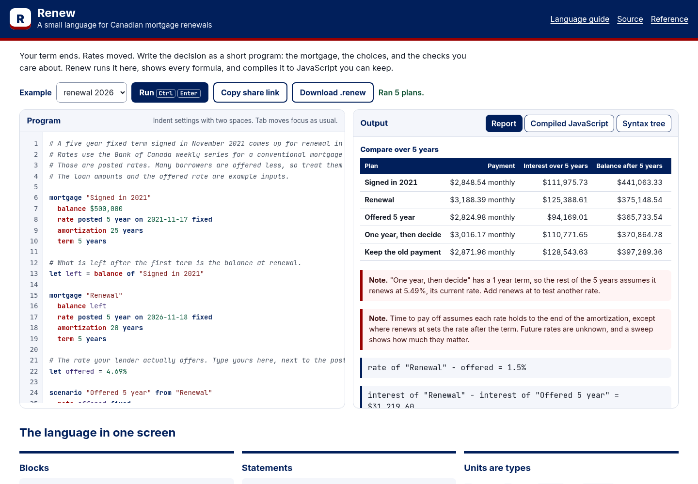

# Renew

[](https://github.com/ALENZACODES/renew-lang/actions/workflows/pages.yml)

**A small language for Canadian mortgage renewal decisions.**

**Playground:** https://alenzacodes.github.io/renew-lang/playground/



When a mortgage term ends, the borrower has a few weeks to compare a handful of choices: renew for five years, take a shorter term, stretch the amortization to keep the payment, pay extra. Each choice is a small calculation, and most people do it in a spreadsheet they cannot check or a calculator that hides its maths. Renew turns the decision into a short program you can read, run, share and rerun when rates move.

## Who it is for

Renew is for a borrower coming up to renewal who is comfortable editing a short text file, and for developers who want renewal maths they can read, test and compile into their own page. It is not meant to replace a conversation with a lender. It is meant to make the arithmetic behind that conversation visible.

## The 2026 renewal example

```renew
# A five year fixed term signed in November 2021 comes up for renewal in November 2026.
# Rates use the Bank of Canada weekly series for a conventional mortgage offered by chartered banks.
# Those are posted rates. Many borrowers are offered less, so treat them as a benchmark, not a quote.
# The loan amounts and the offered rate are example inputs.

mortgage "Signed in 2021"
  balance $500,000
  rate posted 5 year on 2021-11-17 fixed
  amortization 25 years
  term 5 years

# What is left after the first term is the balance at renewal.
let left = balance of "Signed in 2021"

mortgage "Renewal"
  balance left
  rate posted 5 year on 2026-11-18 fixed
  amortization 20 years
  term 5 years

# The rate your lender actually offers. Type yours here, next to the posted benchmark above.
let offered = 4.69%

scenario "Offered 5 year" from "Renewal"
  rate offered fixed

scenario "One year, then decide" from "Renewal"
  rate posted 1 year on 2026-11-18
  term 1 year

scenario "Keep the old payment" from "Renewal"
  amortization 25 years

# Over 5 years every plan covers the same months. A 1 year term is assumed to renew at its
# current rate unless it says renews at, and the report says so under the table.
compare all by payment, interest, balance, payoff over 5 years
show rate of "Renewal" - offered
show interest of "Renewal" - interest of "Offered 5 year"

# What renewal rate in a year would make the 1 year term cost more than locking in the offer?
sweep "One year, then decide" renews from 4.5% to 6.5% step 0.5% by payment, interest, balance over 5 years

explain "Renewal"
check payment of "Keep the old payment" <= payment of "Signed in 2021" * 1.1
```

Output:

```
Compare over 5 years
Plan                   Payment            Interest over 5 years  Balance after 5 years  Time to pay off
=====================  =================  =====================  =====================  ===============
Signed in 2021         $2,848.54 monthly  $111,975.73            $441,063.33            25 years
Renewal                $3,188.39 monthly  $125,388.61            $375,148.54            20 years
Offered 5 year         $2,824.98 monthly  $94,169.01             $365,733.54            20 years
One year, then decide  $3,016.17 monthly  $110,771.65            $370,864.78            20 years
Keep the old payment   $2,871.96 monthly  $128,543.63            $397,289.36            25 years
Note: "One year, then decide" has a 1 year term, so the rest of the 5 years assumes it renews at 5.49%, its current rate. Add renews at to test another rate.
Note: Time to pay off assumes each rate holds to the end of the amortization, except where renews at sets the rate after the term. Future rates are unknown, and a sweep shows how much they matter.

rate of "Renewal" - offered = 1.5%

interest of "Renewal" - interest of "Offered 5 year" = $31,219.60

Sweep renews for "One year, then decide" over 5 years
Renews  Payment            Interest over 5 years  Balance after 5 years
======  =================  =====================  =====================
4.5%    $3,016.17 monthly  $94,731.72             $365,693.01
5%      $3,016.17 monthly  $102,819.40            $368,344.21
5.5%    $3,016.17 monthly  $110,934.19            $370,915.48
6%      $3,016.17 monthly  $119,073.36            $373,406.49
6.5%    $3,016.17 monthly  $127,234.14            $375,817.35
Note: Every row has a 1 year term, so the rest of the 5 years uses the renews at rate in the first column.

How Renewal is worked out
  ...

PASS  payment of "Keep the old payment" <= payment of "Signed in 2021" * 1.1  ($2,871.96 <= $3,133.39)
```

Two things in that output matter more than any single number. The comparison runs over the same 5 years for every plan, and the note under the table says what was assumed for the 1 year term after its first year. The sweep then shows that even if the 1 year term renews at 4.5% next year, the lowest rate in the sweep, it pays more interest over those 5 years ($94,731.72) than locking in the 4.69% offer ($94,169.01).

The posted rates are real: `posted 5 year on 2021-11-17` reads 4.79% and `posted 5 year on 2026-11-18` reads 6.19% from the Bank of Canada weekly series for a conventional mortgage offered by chartered banks. Those are posted rates, a benchmark. Many borrowers are offered less. The offered rate (4.69%) and the loan amounts are example inputs: type your own.

## Renew next to a spreadsheet

A careful spreadsheet can do every calculation Renew does. The difference is what the format catches and what it keeps visible.

| Question | Spreadsheet | Renew |
| --- | --- | --- |
| A rate typed as 5 instead of 5% | Accepted, and the payment is wrong | Refused: `Add a percent sign, like 5%.` |
| Money times money, or money plus a rate | Accepted | Refused before anything runs, naming both types |
| A second option that changes one thing | Copy the block of cells and hope every reference moved | `scenario "Offered" from "Renewal"` then the one line that changes |
| Comparing a 1 year term with a 5 year term | Nothing warns you | A note under the table, and `over 5 years` for an equal horizon |
| What rate fits my budget | Goal Seek, one cell at a time | `rate needed for "Renewal" at $3,000` |
| A rule like "payment within 10% of today" | A formula someone has to remember to look at | `check`, which prints PASS or FAIL with both sides |
| Where a posted rate came from | A pasted number | The series id and week, kept in compiled output as a comment |
| Reviewing a change | Open each cell | A plain text diff |
| Using it in an app | Rebuild the formulas | `compile` gives standalone JavaScript |

Where a spreadsheet is better: charts, a grid people already know, and free form what ifs that do not fit Renew's few statements.

## What makes it a language

- **Units are types.** `$`, `%`, `years` and `months` are part of the syntax. `rate 5` is refused with `Add a percent sign, like 5%.` and `$5 * $5` is refused before anything runs.
- **Scenarios are differences.** A scenario copies a mortgage and states only what changes.
- **Fair comparisons.** `compare ... over 5 years` follows every plan for the same months. Without it, a comparison of plans with different terms carries a warning.
- **A simple rate path.** `renews at 5.5%` sets the rate after the term, and the payment is worked out again at renewal. Without it, the rate is assumed to stay the same, and the report says so wherever a payoff figure appears.
- **Sweeps.** `sweep "Renewal" rate from 4% to 7% step 0.5%` gives one row per value, with the values type checked against the setting.
- **It shows its work.** `explain` prints every formula with the real numbers in it.
- **It works backwards.** `rate needed for "Renewal" at $2,600` and `amortization needed for "Renewal" at $2,600` solve for the input that fits a budget.
- **Two back ends.** A tree walking interpreter, and a compiler that turns a program into self contained JavaScript. Both are tested to give byte identical reports.
- **Errors that teach.** Line, column, a caret under the problem, and the closest valid word.

`fixed` and `variable` after a rate are labels. Renew holds the rate you write for the whole term, and `explain` says so for a plan marked `variable`. A rate that moves inside a term is not modelled yet.

## Use it

In the browser: open the [playground](https://alenzacodes.github.io/renew-lang/playground/). Pick an example, edit, and the report updates as you type. Tabs show the compiled JavaScript and the syntax tree. **Copy share link** puts the whole program in the link.

On the command line, with Node 18 or newer and no installs:

```bash
node bin/renew.js run examples/01-renewal-2026.renew
node bin/renew.js check examples/03-budget.renew
node bin/renew.js compile examples/02-pay-it-down.renew > plan.js && node plan.js
```

## Documentation

- [docs/LANGUAGE.md](docs/LANGUAGE.md): grammar, types, measures, horizons, sweeps, the maths and its sources, posted rates, errors.
- [docs/DESIGN.md](docs/DESIGN.md): design principles and how the lexer, parser, checker, interpreter and compiler fit together.
- [examples/](examples/): a 2026 renewal, ways to pay down faster, working back from a budget, and the smallest program.

## Tests

```bash
npm test
python3 tests/browser_check.py http://127.0.0.1:8080/playground/ path/to/axe.min.js
```

GitHub Actions runs `npm test` on every push before the playground is published; the badge above shows the latest run.

- `test_math.mjs` (48 checks): the payment formula against closed forms, five rate and frequency mixes, zero rates, accelerated payments, extra and lump sums, the solvers, and formatting. Includes the classic $100,000 at 5% over 25 years, $581.60 a month.
- `test_language.mjs` (97 checks): values and units, scenario inheritance, comments and line endings, checks, posted rate lookup, and 25 error cases with their line, column and hint.
- `test_round2.mjs` (68 checks): equal horizons and the different term warning, `renews at`, sweeps and their type errors, the `variable` label, payoff assumptions, and runtime errors that must read the same from the interpreter and from compiled code. The horizon and `renews at` figures were also reproduced with a separate Python calculation using decimal cent rounding.
- `test_compiler.mjs` (307 checks): 4 examples and 300 random programs, compiled and interpreted, must match byte for byte, plus 3 checks that compiled code has no `require`, folds posted rates in as cited constants, and comments each source line. Each random program uses every statement (including `compare ... over` and `sweep`), every measure, both solvers, posted and typed rates, all compounding choices and payment frequencies, `extra`, `lump`, `renews at`, and the `fixed` and `variable` labels. Error paths are tested in the two files above, not by the generator.
- `test_cli.mjs` (6 checks): run, check, compile and exit codes.
- `browser_check.py`: every example at desktop and phone width, the error state, keyboard tab switching, no sideways scroll, and axe-core with WCAG 2.2 AA rules. An automated check, not a full accessibility audit.

No borrower has used Renew in a recorded session yet. Formal user testing is still to come.

## Project layout

```
src/kernel.js        maths and report formatting, shared by both back ends
src/renew.js         lexer, parser, checker, interpreter, compiler
src/posted_rates.js  generated from data/posted_rates.json
bin/renew.js         command line
playground/          browser playground, no build step
examples/            sample programs
tests/               Node tests and the browser check
```

## Sources

- Interest Act, R.S.C. 1985, c. I-15, ss. 6 and 10, read on November 19, 2026, America/Toronto: https://laws-lois.justice.gc.ca/eng/acts/I-15/FullText.html . Section 6 requires a blended payment mortgage to state the rate "calculated yearly or half-yearly, not in advance"; Renew's half yearly default is the usual convention, not a rule of the calculation. Section 10 (1) applies only where the mortgage money is not payable until more than five years after the mortgage date, only after those five years, and s. 10 (2) excludes mortgages given by a corporation.
- Bank of Canada, Valet series V80691333, V80691334 and V80691335, retrieved November 19, 2026, America/Toronto: https://www.bankofcanada.ca/valet/observations/V80691333,V80691334,V80691335/csv?start_date=2016-01-01 (terms: https://www.bankofcanada.ca/terms/)

Renew is a planning tool. It is not financial advice and it does not quote lender rates.

## Credits

Designed and built by John Khan, Toronto, Ontario, a current student, for Syntax Summit. Solo project. No third party code ships in the language or the playground. Playwright and axe-core are used only as test tools.

## License

MIT. See [LICENSE](LICENSE).
